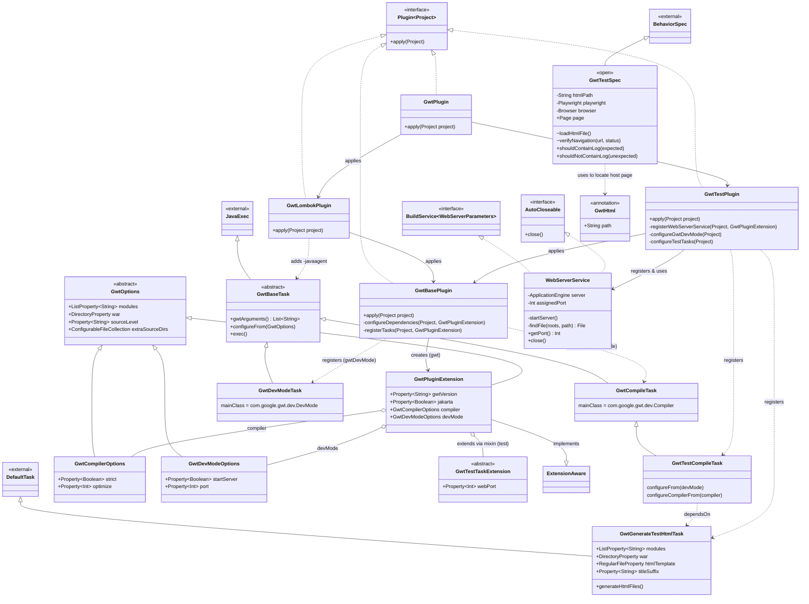

# GWT Gradle Plugin Class Diagram

이 문서는 `gwt` 프로젝트의 주요 클래스 구조와 관계를 정의합니다.

## 1. 클래스 다이어그램 (Mermaid)

## 2. 핵심 클래스 설명

### 2.1 플러그인 (Plugins)
*   **GwtPlugin**: 통합 플러그인. 내부적으로 `GwtLombokPlugin`과 `GwtTestPlugin`을 모두 적용하여 전체 기능을 활성화합니다.
*   **GwtBasePlugin**: GWT 빌드 기반 플러그인(외부 `org.docstr.gwt` 대체). `gwt` 확장, `gwtDev`/`gwtDevRuntimeClasspath` 설정, GWT 의존성(BOM, gwt-dev/user/codeserver, gwt-servlet), `gwtCompile`·`gwtDevMode` 태스크를 등록합니다. 다른 플러그인이 내부적으로 적용하며 별도 ID는 없습니다.
*   **GwtLombokPlugin**: `annotationProcessor`에 Lombok이 있으면 모든 GWT 태스크(`GwtBaseTask`)에 `-javaagent:<lombok.jar>=ECJ`를 붙여, GWT 컴파일러(ECJ)가 Lombok 어노테이션을 처리하게 합니다. Lombok jar는 설정 단계가 아니라 태스크 실행 시점에 찾습니다(`LombokAgentArgumentProvider`). 또한 `main`/`test` 소스셋에 어노테이션 프로세서 생성 디렉토리를 추가합니다.
*   **GwtTestPlugin**: 테스트 환경의 핵심 플러그인. GWT 전용 컴파일 태스크와 HTML 생성 태스크를 등록하고, 웹 서버 서비스를 구성합니다.

### 2.2 태스크 및 설정 (Tasks & Extensions)
*   **GwtPluginExtension / GwtOptions / GwtCompilerOptions / GwtDevModeOptions**: `gwt { ... }` DSL. 공통 옵션(`modules`, `war`, `sourceLevel` 등), 컴파일러 전용 `compiler { ... }` 블록(`strict` 등, `gwtCompile`·`gwtTestCompile`에 적용), `devMode { ... }` 블록을 제공하며, 하위 블록에 지정하지 않은 공통 옵션은 상위 값을 이어받습니다.
*   **GwtBaseTask / GwtCompileTask / GwtDevModeTask**: `JavaExec` 기반으로 GWT `Compiler`·`DevMode`를 실행합니다. 옵션을 GWT 커맨드라인 인자로 변환하고 클래스패스를 구성합니다.
*   **GwtGenerateTestHtmlTask**: GWT 모듈을 브라우저에서 실행하기 위한 `.html` 호스트 파일을 자동 생성합니다.
*   **GwtTestCompileTask**: `GwtCompileTask`를 확장하여, `devMode { }` 설정과 `compiler { }` 전용 옵션으로 테스트 모듈을 컴파일합니다. 테스트 소스 디렉토리와 테스트 런타임 클래스패스는 `GwtTestPlugin`이 `gwt.devMode.extraSourceDirs`에 추가합니다.
*   **GwtTestTaskExtension**: 테스트 전용 추가 설정을 정의합니다. 현재 웹 서버 포트 지정을 위한 `webPort` 속성을 제공하며, `gwt` 익스텐션의 하위 블록(`test`)으로 노출됩니다.

### 2.3 인프라 및 테스트 (Infrastructure & Testing)
*   **WebServerService**: Gradle의 `Shared Build Service`를 구현하며, Ktor 기반의 임베디드 서버를 관리합니다. 프로젝트마다 하나씩 등록되어(루트 `gwtWebServer-<name>`, 하위 프로젝트 `gwtWebServer:<path>`) 같은 프로젝트의 테스트 태스크들이 공유하고, 빌드 종료 시 `close()`로 정리됩니다.
*   **GwtTestSpec**: `Kotest`의 `BehaviorSpec`을 상속받은 베이스 클래스입니다. `Playwright`를 내장하여 실제 브라우저 환경에서 GWT 코드를 검증하는 기능을 제공합니다.
*   **GwtHtml**: 테스트 클래스에 사용되는 어노테이션으로, 해당 테스트가 참조할 HTML 호스트 파일의 경로를 정의합니다.
